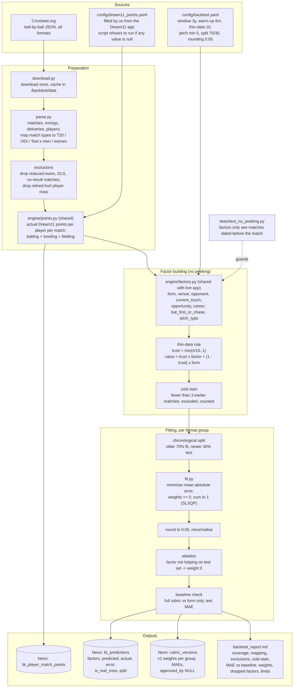
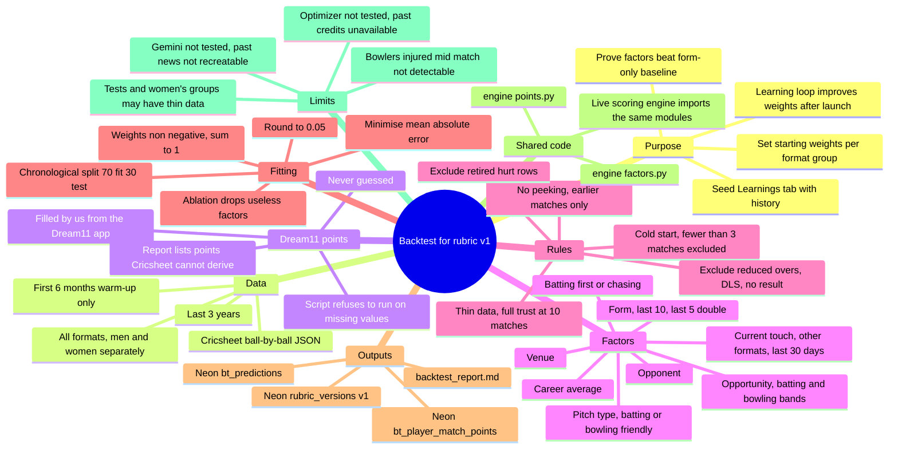

# Backtest: Components Map and Mind Map

Companion to the backtest prompt. Purpose: produce **rubric v1** (factor weights per format group) from past matches, prove the factors beat a form-only baseline, and seed the Learnings tab with history. Pure data processing, no AI API. Runs once before launch, and again whenever weights are refreshed (e.g. a new season).

File paths below are a suggested structure; adjust if the repo already has conventions.

---

## 1. Components map

### Component table

| Component | Suggested file | Input | Output | Rules |
|---|---|---|---|---|
| Downloader | `backtest/download.py` | cricsheet.org | JSON files in `/backtest/data` | Download once; never re-download if present |
| Parser | `backtest/parse.py` | Cricsheet JSON | Matches, deliveries, players with format group and gender | Print the match-type mapping used |
| Exclusions | `backtest/parse.py` | Parsed matches | Clean match set | Drop reduced-overs, DLS, no-result; drop retired-hurt player rows; document detection rule |
| Points calculator | `engine/points.py` **(shared)** | Deliveries + `dream11_points.yaml` | Actual points per player per match (batting, bowling, fielding, total) | No values from memory; refuse to run on nulls; list point types Cricsheet cannot derive |
| Factor builder | `engine/factors.py` **(shared)** | Earlier matches only | 8 factor values per player per match | Same format group; definitions below; live app imports this module |
| Thin-data rule | `engine/factors.py` | Factor average + match count n | Blended value | trust = min(n/10, 1); n = 0 -> form; applies to venue, opponent, opportunity, bat_first_or_chase, pitch_type |
| Cold start | `backtest/run_backtest.py` | Player history | Included / excluded flag | Fewer than 3 earlier matches -> excluded and counted |
| Splitter | `backtest/fit.py` | Evaluated rows | Fit set, test set | Chronological 70/30; warm-up 6 months never evaluated |
| Weight fitter | `backtest/fit.py` | Fit set | Weights per group | Minimise MAE; weights >= 0, sum to 1; round to 0.05 |
| Ablation + baseline | `backtest/fit.py` | Test set | Final weights, MAEs | Drop factors that don't help; compare to form-only |
| Writer | `backtest/run_backtest.py` | All results | 3 Neon tables + report | `DATABASE_URL` from env, never hardcoded |
| No-peeking test | `tests/test_no_peeking.py` | Factor functions | Pass / fail | Factors receive only matches dated strictly before the match |

### Factor definitions (each = player's average Dream11 points in situation X, same format group, earlier matches only)

| Factor | Definition | Thin-data rule? |
|---|---|---|
| form | Last 10 matches; most recent 5 weighted double | No (it is the fallback) |
| venue | Average at this venue | Yes |
| opponent | Average against this opposing team | Yes |
| current_touch | Last 5 matches in other formats within 30 days; ratio = points / his average in that format; value = form x mean(ratio); none -> form | No |
| opportunity | Average in matches where batting band (1-3, 4-5, 6-7, 8+) and bowling band (none / under half quota / half or more) match his usual bands (most frequent in last 10) | Yes |
| career | Average over all earlier matches in the window | No |
| bat_first_or_chase | Average when his team batted first vs chased, matching this match's actual situation | Yes |
| pitch_type | Venue = batting- or bowling-friendly by average first-innings score vs format average (needs 5+ earlier matches, else unknown -> form); average at venues of same type | Yes |

---

## 2. Mind map

---

## 3. Run order

1. Fill `config/dream11_points.yaml` from the Dream11 app (one section per format).
2. Set `DATABASE_URL` to the Neon connection string.
3. Claude Code shows its plan and the Cricsheet fields it will use; review, then approve.
4. Run `tests/test_no_peeking.py`; it must pass before any fitting.
5. Run the backtest.
6. Read `backtest_report.md`: the rubric must beat form-only on the test set; note any groups flagged as thin.
7. Rubric v1 is now in `rubric_versions`; the live scoring engine reads it and uses the same `engine/` modules.
