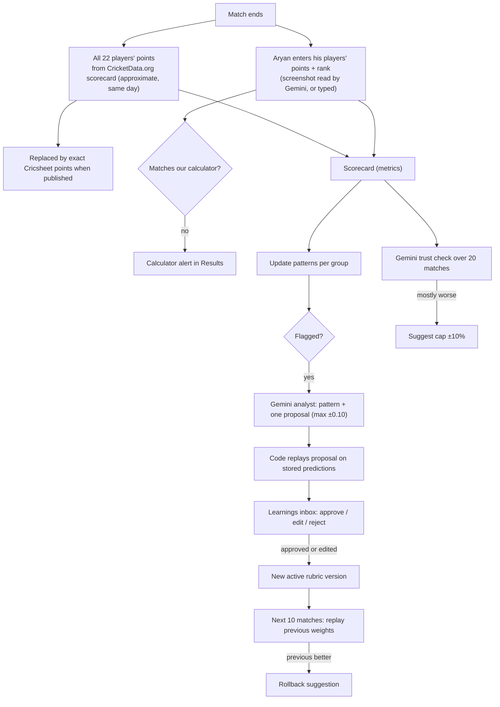

# Learning Loop

Checks predictions after every match and improves the rubric over time. **Gemini does not learn.** What changes is the rubric's weights (`rubric_versions`). Every change needs evidence, a history check, and Aryan's approval. Numbers below are settings (`RUBRIC.md` section 11).

---

## 1. Flow

---

## 2. Actual points

| Source | Covers | When | Stored |
|---|---|---|---|
| CricketData.org scorecard + Dream11 points table | All 22 | Same day | `player_match_points`, `source = scorecard`, provisional |
| Cricsheet + same table | All 22 | When published | Replaces the row, `source = cricsheet` |
| Aryan's entry | His players + rank | After the match | `results` |

- The system cannot read Dream11. Aryan's saved *My final team* is treated as what he entered.
- **Calculator check:** for Aryan's players, `results.mismatch = (aryan_points ≠ calc_points)`. Any mismatch shows an alert in Results ("Check the points table in Settings"); logged; saving is not blocked.

---

## 3. Scorecard (`metrics`, per match)

| Measure | Definition |
|---|---|
| Prediction error | predicted (adjusted) − actual per player; real miss = error larger than 1.5 × the group's typical miss (backtest test MAE; RUBRIC.md section 9) |
| Points ROI | system team actual − simple team actual |
| Efficiency | system team actual ÷ perfect team actual |
| Captain hit | captain in the match's top 3 scorers |
| Override hit rate | share of Aryan's swaps where his player outscored the system's |
| Gemini value | share of adjustments that moved the prediction closer to actual (also sets `gemini_adjustments.helped`) |

- **Simple team:** top 11 by average points over the last 10 matches, made valid by the optimizer, top average as captain.
- **Perfect team:** optimizer run on actual points (hindsight best valid team).
- Team totals include captain 2x and VC 1.5x.
- Metrics are recomputed when exact Cricsheet points replace provisional ones (`points_final = true`).
- Rain-shortened matches and players injured mid-match: `excluded_from_learning = true` (still shown to Aryan).

---

## 4. Flag rule (`patterns`)

Per format group, for each group type (role, batting position band, batting first vs chasing, pitch type/venue) and value:

- Window: the group's last 5 matches (changed from 10 on 13 Oct 2026; settings `flag_window_matches`, `flag_min_misses`).
- Flag when real misses ≥ 5 **and** ≥ 70% point the same direction.
- Status `watching` otherwise; `resolved` after an approved change or a rejection (re-evaluated on new matches).

---

## 5. Suggestions (`weight_suggestions`)

**Weight change**
1. Gemini analyst gets the flagged pattern (GEMINI_RULES.md, Job 3) and proposes one factor change, max ±0.10, or "no change".
2. Code renormalises to sum to 1 and replays on stored predictions for that format group: `history_mae_before` vs `history_mae_after`. Not lower → `not_supported`.
3. Aryan approves, edits (warning beyond ±0.10) or rejects. Approve/edit creates a new `rubric_versions` row (`approved_change` or `aryan_edit`), set active from the next run.

**Rollback**
- After a version change, once 5 new matches exist in that group, replay the previous weights on those matches using stored factor values. If the previous version's error is lower, create a `rollback` suggestion. Approval re-activates the previous weights as a new version (`source = rollback`).

**Gemini cap**
- Over the last 20 matches with adjustments, if Gemini's adjustments mostly made predictions worse (helped = false in the majority), create a `gemini_cap` suggestion to lower `gemini_cap_percent` to 10. Approval updates the setting.

---

## 6. Tests

- Fewer than 10 real misses, or under 70% same direction, never flags.
- Provisional points are replaced, not duplicated; metrics recompute.
- Mismatch between Aryan's and calculated points always sets `mismatch` and shows the alert.
- Proposals beyond ±0.10 are rejected; weights always sum to 1.
- Replays use stored factor values only.
- Excluded matches never count toward flags.
