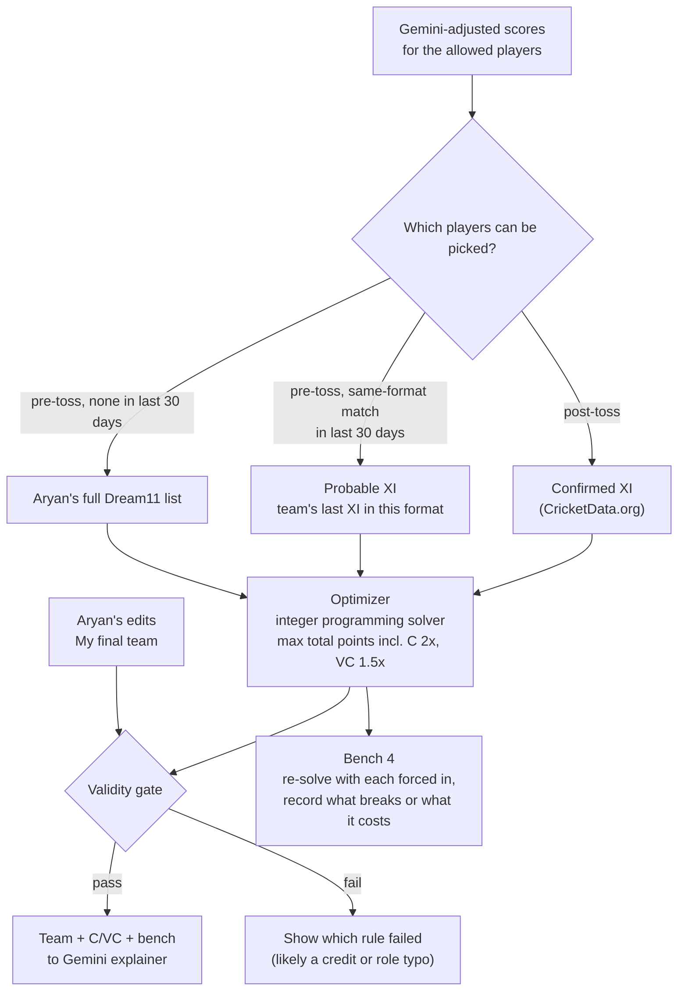

# Optimizer + Validity Gate: Design Spec

The optimizer picks the best valid 11, the captain and vice-captain, and the 4 bench players. The validity gate is the final check on every team, including Aryan's edits. Both are code; no AI.

---

## 1. Flow

---

## 2. Player pool

| Run | Pool |
|---|---|
| Post-toss | Confirmed playing XI of both teams (CricketData.org), within Aryan's Dream11 list |
| Pre-toss, team played this format in the last 30 days | Probable XI: that team's XI from its most recent match **in this format** |
| Pre-toss, no same-format match in the last 30 days | Aryan's full Dream11 list for that team |

The pool is decided per team, so one side can use its probable XI while the other uses the full list. A probable-XI player missing from Aryan's Dream11 list is left out. Pre-toss results are labelled **Provisional**.

---

## 3. Optimizer

**Goal:** maximise total expected points = sum of the 11 adjusted scores + 1 × captain's score + 0.5 × vice-captain's score (captain 2x, VC 1.5x).

**Method:** integer programming (e.g. PuLP or OR-Tools, Python), with a yes/no variable per player for "picked", "captain" and "vice-captain". This finds the guaranteed best team, not an approximation. Choosing team and captaincy together is optimal; in the best team the captain is always the highest scorer and the VC the second highest, which matches the rubric rule.

**Constraints**, all read from the Dream11 rules settings in Neon, never hardcoded:

| Constraint | Source |
|---|---|
| Exactly 11 players | Settings |
| Total credits within budget | Settings + Aryan's credits |
| Each role (WK, BAT, AR, BOWL) within its min and max | Settings + Aryan's Dream11 roles |
| At most N players from one side | Settings |
| Exactly one captain and one vice-captain, both picked, not the same player | Fixed |
| Only players from the pool (section 2) | Pool |

**Tie-break:** if two teams have the same total, prefer the one with fewer thin-data players.

---

## 4. Bench 4

1. Take the 4 highest-scoring players in the pool who were not picked.
2. For each, re-run the solver with that player forced in.
3. Record the reason:
   - No valid team possible with him: name the rule that breaks (e.g. "would exceed credits by 1.5", "would break the bowler maximum", "would exceed the per-side cap").
   - Valid but worse: "fits, but the team scores X points less".
4. Pass these reasons to the Gemini explainer, which turns them into one line each.

---

## 5. Validity gate

Runs on the optimizer's team and on every edit Aryan makes in **My final team**.

| Check | Fail message (example) |
|---|---|
| Exactly 11 players, no duplicates | "You have 10 players: add one more." |
| Credits within budget | "1.5 credits over: swap a player for a cheaper one." |
| Role minimum and maximum | "Only 2 bowlers: the minimum is 3." |
| Per-side cap | "8 players from India: the maximum is 7." |
| All players in the pool | "Player X is not in the confirmed XI." |
| Captain and VC both picked and different | "Choose a different vice-captain." |

- An invalid team **cannot be saved**. The app shows the message and a fix hint.
- **If the optimizer finds no valid team at all**, the app tells Aryan which rule can't be met, since this almost always means a typo in a credit or role entry.
- When Aryan's edit passes, it is saved to Neon as an override with his optional reason.

---

## 6. Outputs (saved to Neon)

| Table | What is saved |
|---|---|
| teams | Run type, the 11, captain, VC, total expected points, rubric version, pool type used (confirmed / probable / full) |
| bench | 4 players with the solver's reason |
| overrides | Aryan's edits: players swapped, captaincy changes, reason, validity result |

---

## 7. Tests

- Always returns a team that passes every validity check, or a clear "no valid team" message.
- Captain is the highest and VC the second-highest scorer in the returned team.
- Changing a setting (e.g. per-side cap) changes the result without code changes.
- Each bench reason matches what actually happens when that player is forced in.
- The gate rejects each kind of invalid edit with the right message.
- Pool rules: post-toss uses the confirmed XI; pre-toss uses the probable XI only when a same-format match exists in the last 30 days.
