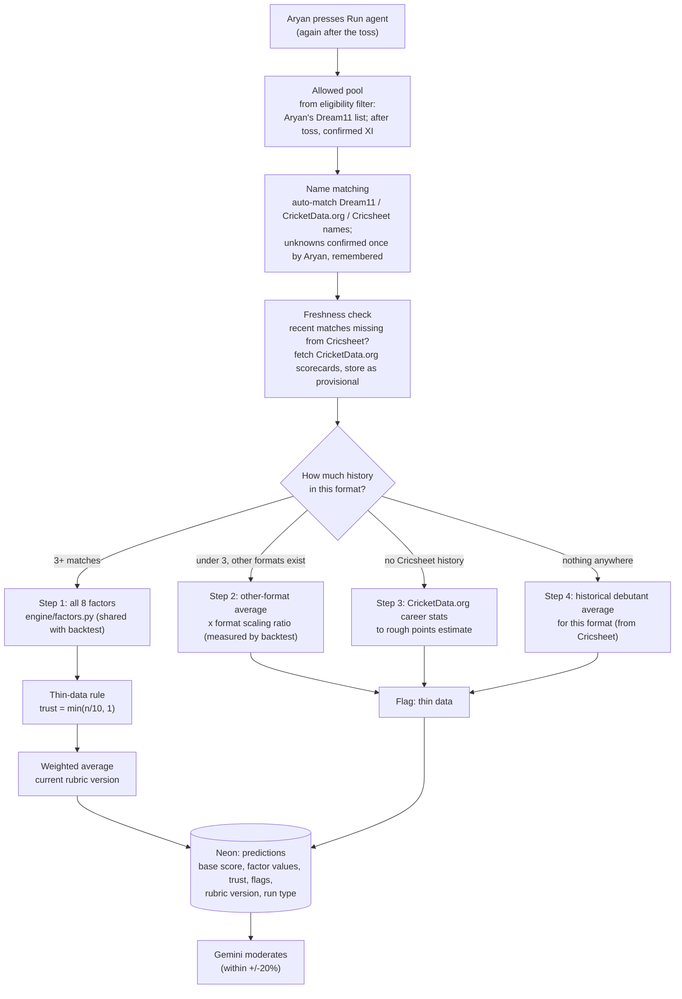

# Scoring Engine: Design Spec

## Status (12 Oct 2026): built, with fix-ups pending

The engine was built standalone (`docs/SCORING_ENGINE_BUILD.md` was the build pack). Verified:
- 23 tests pass, 1 skipped (the migration test, which needs a live database).
- Two runs on Pakistan vs Sri Lanka, 3rd T20I gave identical output (determinism).
- Base scores match the weights by hand (e.g. Maaz Sadaqat: 0.14×79.7 + 0.05×85.2 + 0.05×81.5 + 0.76×53.7 = 60.3, shown as 60.2 from unrounded values).
- Rubric version used is flagged provisional; provisional scorecard rows are reported as warnings.

**What exists:** `engine/settings.py`, `rubric.py`, `matching.py`, `fresh.py`, `fallback.py`, `score.py`, `groups.py`, `db.py`, `env.py`, `cricsheet_refresh.py`, `cli.py`, `sources/cricketdata.py`; migrations `001_core_tables` to `004_seed_settings`; fixtures in `tests/fixtures/cricketdata/`.

**Confirmed CricketData.org data (from saved fixtures):**
- Endpoints used: matches, currentMatches, series_info, match_info, match_squad, match_scorecard, players_info.
- Squad players: `id`, `name`, `role`, `battingStyle`, `bowlingStyle`, `country`, `playerImg`.
- Player info: `id`, `name`, `dateOfBirth`, `role`, `battingStyle`, `placeOfBirth`, `country`, `playerImg`, `stats` (rows with `fn`, `matchtype`, `stat`, `value`; matchtypes seen: ipl, odi, t20, t20i, test).
- `playerImg` is sometimes a **generic placeholder** (`https://h.cricapi.com/img/icon512.png`): treat that as "no photo".
- Career stats have runs, innings and wickets, but **no catches**.
- `bowlingStyle` exists for current players, so a bowling-style source exists for squads (useful later for pace vs spin).

### Fix-ups required (in this order)

1. **Name matching coverage (critical).** On the test run, 8 of 22 players were unmatched and silently not scored, including Dasun Shanaka, Kusal Mendis and Kamindu Mendis. Cricsheet often stores initials plus surname (e.g. "MD Shanaka"), and two players can share a surname (Kusal and Kamindu Mendis). Extend `matching.py` with these extra steps, after the existing ones, each accepted only if exactly one candidate remains:
   - a. **Cricsheet register:** check the Cricsheet people register files (downloadable from cricsheet.org) for full or alternative names. `TODO-CONFIRM` which file and columns hold them before using it.
   - b. **Surname + given-name initial within the team:** candidates who played for that team in the last 12 months; same surname; the source name's first initial appears in the Cricsheet initials (e.g. "Dasun Shanaka" ↔ "MD Shanaka").
   - c. Still ambiguous or none → unmatched, and add a CLI command `python -m engine.cli link --source cricketdata --name "Kusal Mendis" --player <id>` to confirm once (the UI does this later).
   - Report matched coverage per run ("20 of 22 matched") and add a warning when more than 1 player is unmatched. Add tests for both examples above.
2. **Fallback step 2 date:** `fallback()` reads history up to `"9999-12-31"`. Pass the match date instead, so no match on or after the match date is ever used (same no-peeking rule as factors). Add a test.
3. **Player photos:** when saving `players.image_url`, store `null` if `playerImg` is the generic placeholder above, so the UI shows the initials avatar.
4. **TODO-CONFIRM (already in code):** whether CricketData.org's `t20` career stats include T20Is.
5. **Protect the 100-calls-a-day free limit (critical).** One test run already showed 47 calls used that day. Add:
   - **Data mode** via env `CRICKETDATA_MODE`:
     - `offline`: never calls the API; uses saved fixtures and the Neon cache only. **Default for development and all tests.**
     - `cache_only`: uses only what is already cached in Neon; no new calls.
     - `live`: calls allowed, within the caps below.
   - **Caps** (settings, editable): `cricketdata_daily_limit` 95 (hard stop for the whole day); `cricketdata_dev_daily_limit` 30 (the most that development and testing commands may use in a day, keeping the rest for real use and the demo); `cricketdata_max_calls_per_run` 15 (a single scoring run stops calling and uses cache once it hits this).
   - **`--dry-run`** on every CLI command: prints how many live calls it *would* make (cache misses) without making them.
   - **Longer cache for things that don't change:** finished-match scorecards, squads of past matches and player info are cached permanently (player info refreshed at most every 30 days). Never fetch the same finished scorecard twice.
   - **Fewer calls per run:** fetch each recent match's scorecard once for all players in it (not per player); skip `fresh.fill_recent` for matches Cricsheet already has.
   - **Visibility:** every command ends with "CricketData.org calls: this command N, today M of 95 (dev M of 30)". `python -m engine.cli budget` shows today's calls by command.
   - **Tests** must never call the API (assert this in a test).
   - Do not work around the limit with extra accounts or keys.

Prompt for Claude Code:

> Read `docs/SCORING_ENGINE.md`, section "Fix-ups required". Do fix-up 5 (API budget) first, then fix-ups 1 to 3. Work in `CRICKETDATA_MODE=offline` unless I say otherwise, and use `--dry-run` before any live call. Before changing code, run all tests and report. For fix-up 1, first show me which Cricsheet register file and columns you found (from the real downloaded file), and wait for my go-ahead. Keep diffs small, commit after each fix-up, rerun all tests after each, and stop if any passing test fails. Then rerun `python -m engine.cli score` on the same Pakistan vs Sri Lanka match in `cache_only` mode (no new calls) and show me the new matched count and the call counter.

---

The scoring engine is the calculator. For one match, it applies the current rubric to the data and gives every allowed player a **base score** (expected Dream11 points). It uses no AI. Gemini only sees its output.

- **Rubric** = the marking scheme (factor weights per format group, stored in Neon `rubric_versions`).
- **Scoring engine** = the examiner that applies it, mechanically and identically every time.

---

## 1. Flow

---

## 2. Components

| Component | Suggested file | Job | Data from |
|---|---|---|---|
| Points calculator | `engine/points.py` (shared with backtest) | Converts a player's match into Dream11 points | `config/dream11_points.yaml` |
| Factor builder | `engine/factors.py` (shared with backtest) | Calculates the 8 factors with the thin-data rule | Neon player history |
| Name matcher | `engine/matching.py` | Links one player across Dream11, CricketData.org and Cricsheet | Cricsheet player register, CricketData.org player list, Aryan's confirmations |
| Freshness filler | `engine/fresh.py` | Fills matches Cricsheet hasn't published yet | CricketData.org scorecards |
| Fallback chain | `engine/fallback.py` | Scores players with under 3 matches in the format | Cricsheet other formats, CricketData.org career stats, debutant averages |
| Scorer | `engine/score.py` | Runs everything for one match, returns base scores | All of the above + `rubric_versions` |
| Daily refresh | scheduled job | Loads new Cricsheet matches; replaces provisional rows | Cricsheet |

**Runtime:** the engine runs as a Python serverless function on Vercel, so it imports the exact same `engine/` modules as the backtest. Player history is precomputed in Neon, so each run only scores 22 to 30 players and stays fast.

---

## 3. Rules

**Factors** (same format group, earlier matches only): form, venue, opponent, current_touch, opportunity, career, bat_first_or_chase, pitch_type. Definitions are identical to the backtest (see `BACKTEST_MAP.md`).

**Thin data:** trust = min(n / 10, 1); value = trust x factor + (1 - trust) x form; n = 0 means value = form.

**Pre-toss vs post-toss:**

| | Pre-toss run | Post-toss run |
|---|---|---|
| Pool | Aryan's full Dream11 list | Narrowed to the confirmed XI |
| bat_first_or_chase | Neutral (uses form) | Uses the actual toss result |
| Label | Provisional | Final |

**Fallback chain** (players with under 3 matches in the format), always flagged thin data:

1. 3+ matches: normal scoring.
2. Under 3, but other formats exist: his other-format average x format scaling ratio. Ratios are measured by the backtest from players who played both formats, never guessed.
3. No Cricsheet history: CricketData.org career stats converted to a rough estimate. Confirm which stats the free API returns.
4. Nothing anywhere: historical debutant average for this format, measured from Cricsheet.

**Provisional data:** matches filled from CricketData.org scorecards count normally in form, are marked `provisional = true`, and are replaced automatically once Cricsheet publishes them.

**Warnings raised by the engine:** 3+ picked players flagged thin data contributes to the "check this yourself" warning. (Other warnings, such as XI not confirmed or rain forecast, are raised elsewhere.)

---

## 4. Output per player (saved to Neon `predictions`)

| Field | Meaning |
|---|---|
| match, player, format group, run type | Pre-toss or post-toss |
| base_score | Expected Dream11 points before Gemini |
| factor values (8) | Each factor's blended value |
| trust per factor | 0 to 1, from the thin-data rule |
| fallback_step | 1 to 4 |
| thin_data flag | True for steps 2 to 4, or if key factors have low trust |
| provisional_inputs | Whether any provisional matches were used |
| rubric_version | Which weights were applied |

Gemini receives this record and uses the factor values as raw material for its reasons; it never recalculates them.

---

## 5. CricketData.org call budget

The free tier allows 100 calls a day, so every response is cached in Neon and reused.

| Call | When |
|---|---|
| Fixtures | Once a day (daily refresh) |
| Squads / match info | Pre-toss run |
| Confirmed XI and toss | Post-toss refresh |
| Recent scorecards | Only for matches missing from Cricsheet, once each |
| Player career stats | Only for step 3 players, once each, cached |

If the API is down or the limit is reached, the engine uses cached data and marks the run "data may be stale".

---

## 6. Tests

- Same inputs always give the same base scores.
- Factor functions only receive matches dated before the match (shared no-peeking test).
- A provisional match is replaced, not duplicated, when Cricsheet publishes it.
- Each fallback step triggers correctly and sets the thin-data flag.
- A run with a stale or failing API still completes using cache.

---

## 7. Open items

- [ ] Confirm which player stats CricketData.org's free API returns (for fallback step 3).
- [ ] Confirm CricketData.org endpoint names for fixtures, squads, XI, toss and scorecards.
- [ ] Rubric v1 weights and format scaling ratios: from the backtest.
- [ ] Bowling-style data source, if pace vs spin is added to pitch type later.
